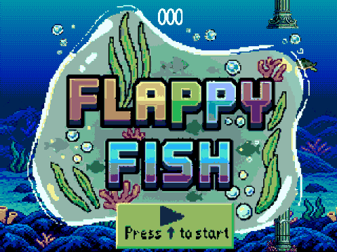
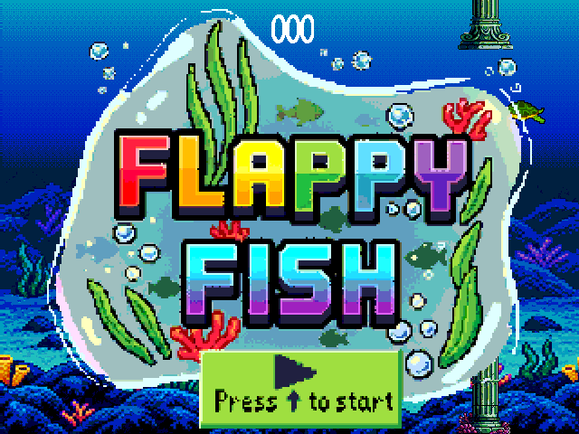
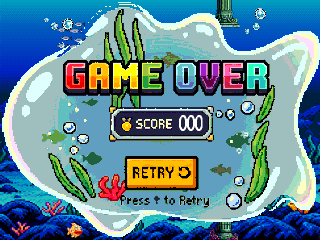
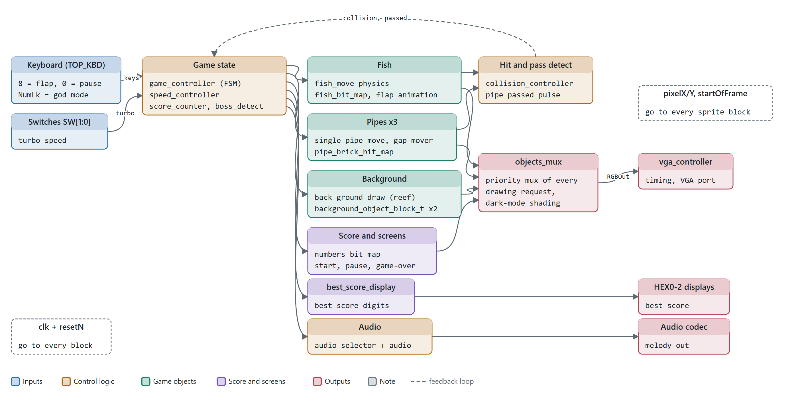

# Hardware Implementation of "Flappy Bird"

**FPGA Lab Project, Technion** — an underwater *Flappy Fish* written entirely in SystemVerilog and running on an
Intel/Altera Cyclone V FPGA (Terasic DE10-Standard board).

[](https://yogevdor.github.io/Lab1Project-Flappy-Bird/)

> **[▶ Play it in your browser](https://yogevdor.github.io/Lab1Project-Flappy-Bird/)** — the page runs *this very RTL*,
> simulated cycle by cycle. Details at the [end of this README](#play-it-in-your-browser).

## Overview

- Designed an end-to-end digital circuit implementation in SystemVerilog on an FPGA board, integrating **VGA graphics**,
  a **PS/2 peripheral interface**, and **sound output**.
- Developed the primary game mechanics using customized **finite state machines** alongside **real-time collision
  detection** modules.
- Optimized hardware resources to meet strict compilation and timing constraints.
- Performed troubleshooting and functional analysis using **ModelSim** logic simulation and the **SignalTap** logic
  analyzer.

There is no processor and no software: every pixel, every game rule and every note of the music is produced by logic
that runs in parallel on the chip.

| | |
|---|---|
|  |  |

## Game features

- **Fish with gravity and flapping** — a flap key gives the fish an upward kick; a 3-frame flap animation plays
  while it swims.
- **Three scrolling pillars** with random gap heights and four pillar designs, drawn from top / middle / bottom bricks.
- **Scoring** — one point per pillar passed (0–999). The best score is shown on the board's 7-segment displays
  (`HEX2..HEX0`) and the current score is drawn on screen.
- **Difficulty ramp** — the pillars get faster every 8 pillars passed (up to a cap); the board's switches add a ×2 / ×3
  speed multiplier.
- **"Boss" levels** — at scores 50–59, 100–109, 150–159, … the pillar gaps move up and down while you fly through them.
- **Dark mode** — at scores 20–29, 70–79, 120–129, … the sea goes dark and only a circle around the fish (which switches
  to a lantern-fish sprite) stays visible.
- **Pause** and a **god mode** toggle (for testing); start, pause and game-over screens.
- **Living background** — a scrolling reef, plus a turtle and a school of sardines swimming by.
- **Sound** — background music while playing and a game-over jingle, played through the board's audio codec.

### Controls

| Action | On the board | In the browser |
|---|---|---|
| Start / flap / retry | PS/2 keyboard, numpad **8** | **Space**, **↑**, **8**, **W**, or click / tap |
| Pause / resume | numpad **0** | **P** or **0** |
| God mode on/off | **NumLock** | **G** |
| Speed ×2 / ×3 | switches **SW0** / **SW1** | check boxes under the game |
| Volume | **KEY3** | — (no sound in the browser) |

## Architecture

The design is a classic "everything is a pixel pipeline" FPGA game: a video timing generator walks over the 640×480
screen, every game object continuously answers *"am I drawn at this pixel, and in what colour?"*, and a priority
multiplexer picks the colour that is sent to the VGA port. The game logic itself advances **once per video frame**.

[](docs/architecture.svg)

*Block diagram of `TOP_FLAPPY_FISH`. Signals flow left to right; the dashed arrow is the feedback loop from collision
and pass detection back into the game state. `clk` / `resetN` go to every block, and `pixelX/Y` and `startOfFrame`
from the VGA controller go to every sprite block.*

### How the pieces fit together

1. **Clock and frame timing.** A PLL turns the board's 50 MHz clock into a **31.5 MHz pixel clock**. `vga_controller`
   generates the 640×480 timing (≈ 72 frames per second), the current `pixelX` / `pixelY`, and a one-clock
   **`startOfFrame`** pulse — the heartbeat of the game: the fish, pillars and background all move exactly once per
   frame.
2. **Input.** The PS/2 interface (`TOP_KBD`: the course's `KBDINTF` block plus `keyPad_decoder`) turns scan codes into
   key-pressed signals. Rising edges of key 8 (flap) and key 0 (pause) are detected inside the logic that uses them.
3. **Game state.** `game_controller` is a four-state FSM — **START SCREEN → GAME ON → GAME OVER → START SCREEN**, with
   **GAME ON ⇄ PAUSE** — that enables the objects, selects which screen is drawn and starts the melodies.
   `speed_controller` (difficulty ramp and turbo switches), `score_counter` (3-digit BCD) and `boss_detect`
   (boss / dark-mode levels) sit next to it.
4. **Game objects.** Every object is the same recipe: a small **motion FSM** that updates a position on
   `startOfFrame`, plus a **bitmap ROM** that returns the colour of the sprite pixel under `pixelX/pixelY`.
   - *Fish* (`fish_move`): fixed-point (1/64 pixel) velocity and gravity, flap impulse, clamped to the screen.
   - *Pipes ×3* (`single_pipe_move`, `gap_mover`, `random`): pillars scroll left and recycle on the right with a new
     random gap height and pillar style; a *passed* pulse is raised once per pillar. (`random` is a fast free-running
     counter that is sampled when a key is pressed.)
   - *Background* (`back_ground_draw`, `background_object_block_t`): a scrolling 640×480 reef and two swimming
     objects.
5. **Collision detection.** `collision_controller` is purely combinational: a hit is **"the fish and a pillar both
   request to draw the same pixel"**, or the fish touching the top / bottom of the screen. The result feeds back into
   `game_controller`.
6. **Drawing.** Each object produces a *drawing request* and an 8-bit colour (**RRRGGGBB**). `objects_mux` picks the
   winner with a fixed layer priority — start screen, score, game-over, pause, dark-mode mask, fish, pillars,
   background objects, background — and applies the dark-mode shading. `vga_controller` sends the colour to the VGA
   port.
7. **Sound.** `audio_selector` chooses the melody, `melody_player_1` steps through note data stored in a ROM
   (`songs.mif`: note, octave, duration, gap), `tone_decoder` / `prescaler` set the pitch, `sine_table` produces the
   samples and the course's audio codec controller sends them to the codec.

All sprites, backgrounds and screens are 8-bit bitmaps (`.mif`) held in on-chip ROMs (about two dozen
`lpm_rom` instances).

## FPGA implementation

| | |
|---|---|
| Board / device | Terasic DE10-Standard — Cyclone V `5CSXFC6D6F31C6` |
| Tool chain | Quartus Prime 17.0 Lite · ModelSim · SignalTap |
| Top level | `TOP_FLAPPY_FISH` (schematic `RTL/VGA/TOP_FLAPPY_FISH.bdf` tying together the SystemVerilog modules) |
| Video | VGA 640×480, 31.5 MHz pixel clock, 8-bit colour |
| Logic utilisation | 1,649 ALMs (**4 %**), 1,069 registers, 5 DSP blocks |
| Memory | 4.5 Mbit of block RAM (**80 %**) holding the bitmaps and the melody |
| Timing | closed at 31.5 MHz — Fmax ≈ 54.7 MHz (slow 85 °C model), setup slack ≈ 13.5 ns |

*Figures from the last full Quartus compile (25 Oct 2026).*

Parts provided by the course and used as-is: the PS/2 interface (`KBDINTF`), the audio-codec controller and the
VGA timing template that `vga_controller` is based on.

## Repository layout

```
RTL/VGA/        game logic and video: FSMs, object motion, bitmap ROM wrappers, objects_mux, vga_controller
RTL/KEYBOARDX/  PS/2 keyboard top, key decoder, random-number generator
RTL/AUDIO/      melody player, tone / sine generation, song data
RTL/Seg7/       7-segment decoder
RTL/*.mif       sprite / background / screen bitmaps
Lab1Demo.qpf    Quartus project (top level: TOP_FLAPPY_FISH); Lab1Demo.qsf holds the pin assignments
photos/         source artwork and the generated bitmap files
docs/           diagrams and screenshots used in this README
```

### Build and run on the board

1. Open `Lab1Demo.qpf` in **Quartus Prime 17.0 Lite** and run *Compile Design*.
2. Connect a VGA monitor, a PS/2 keyboard and speakers / headphones (line out) to the DE10-Standard.
3. Program the FPGA with the generated `output_files/Lab1Demo.sof` using the Programmer.

## Play it in your browser

[](https://yogevdor.github.io/Lab1Project-Flappy-Bird/)

**[▶ Play Flappy Fish](https://yogevdor.github.io/Lab1Project-Flappy-Bird/)** — keyboard: **Space** / **↑** to flap,
**P** to pause, **G** for god mode (or click / tap the game to flap).

This is not a re-implementation: the SystemVerilog above is translated by [Verilator](https://www.veripool.org/verilator/)
into a cycle-accurate model, compiled to WebAssembly, and driven by a small harness that stands in for the board
(VGA output → canvas, keyboard → PS/2 frames, switches → check boxes). The game logic keeps its original speed on any
machine, and on multi-core computers several Web Workers draw frames in parallel to reach a smooth frame rate at full
resolution. Sound is not simulated in the browser.

The browser build lives on its own branch,
[`web-demo`](https://github.com/yogevdor/Lab1Project-Flappy-Bird/tree/web-demo), together with a description of how it
works; it never modifies the RTL on `main` and is rebuilt from it by a GitHub Actions workflow.
